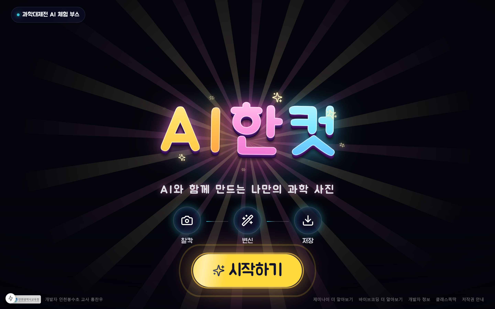
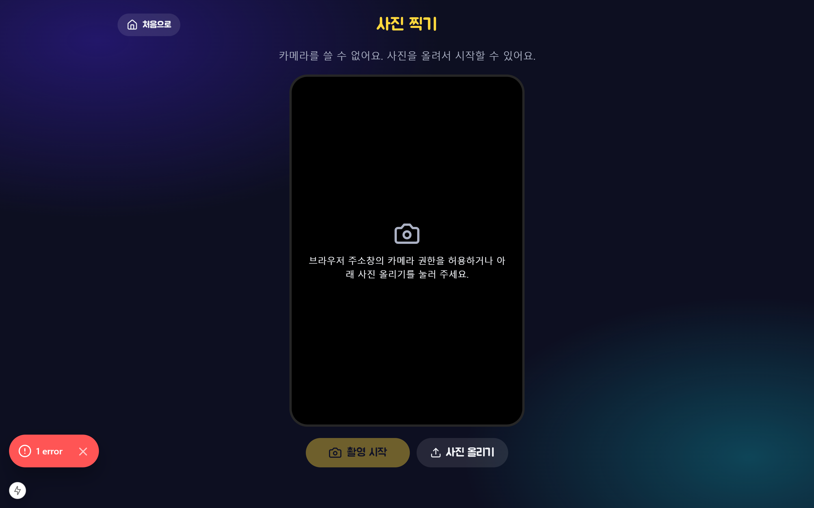
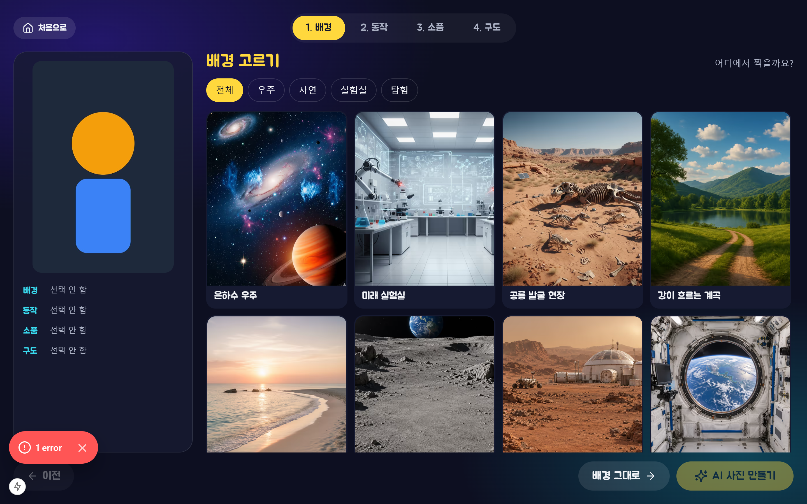
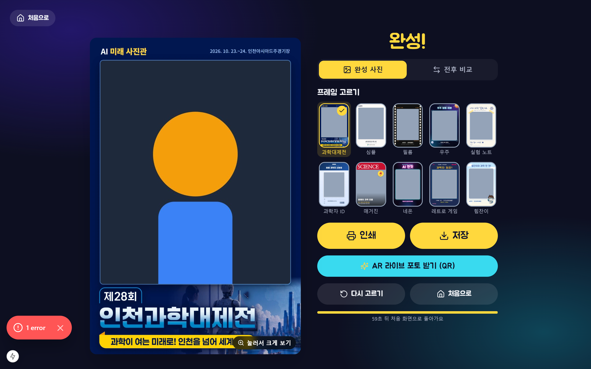
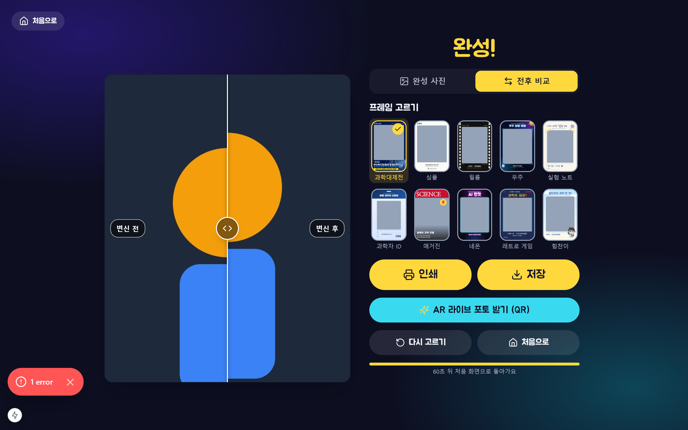
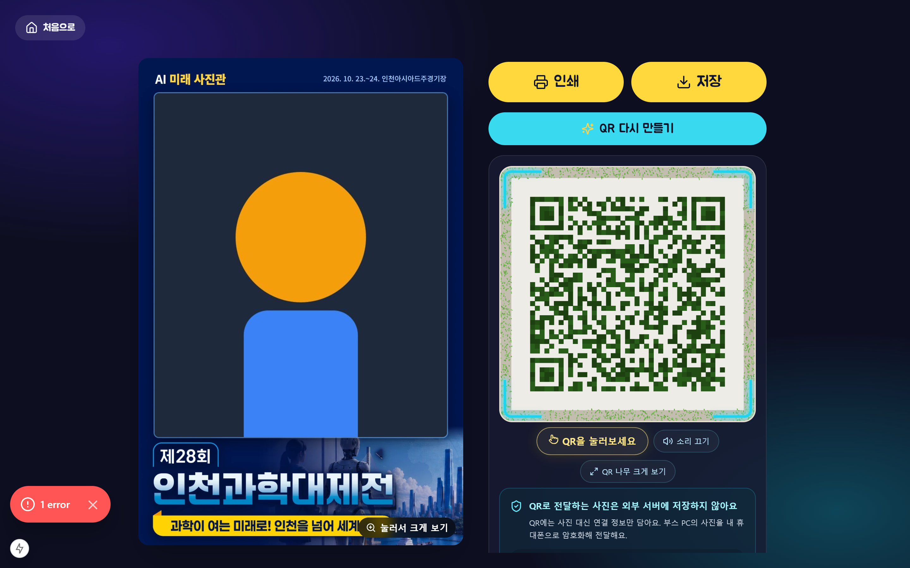

# AI한컷 과학 포토부스 (2026-AIPHOTO)

카메라로 사진을 찍고 배경·동작·소품·구도를 고르면 Vertex AI(Gemini 이미지 모델)가 과학 테마 사진으로 합성해 주는 키오스크용 웹앱입니다. Next.js 15, React 18, Genkit 1.x로 제작되었습니다.

---

## 주요 화면 미리보기

### 1. 메인 로비 (Lobby)
우주와 은하를 형상화한 인터랙티브 캔버스 배경과 직관적인 시작 버튼을 제공합니다.


### 2. 카메라 부스 (Booth)
10초 카운트다운 타이머, 촬영 가이드라인, 카메라 전환 및 사진 직접 업로드 기능을 지원합니다.


### 3. 스튜디오 프리셋 선택 (Studio)
배경 50종, 동작 50종, 과학 소품 50종, 그리고 전문 촬영 구도 기법을 카드 형태로 편리하게 선택할 수 있습니다.


### 4. 결과 및 인쇄 프레임 선택 (Result & Frames)
제28회 인천과학대제전 공식 포스터 테마를 비롯한 10종의 포토 프레임(4×6인치 300dpi) 선택과 즉시 인쇄·저장을 지원합니다.


### 5. 변신 전후 비교 슬라이더 (Before & After)
촬영한 원본 사진과 AI 합성 사진을 인터랙티브 슬라이더로 밀어보며 생생하게 비교할 수 있습니다.


### 6. 무서버 WebRTC QR 전송 포털 (Magic Tree Portal)
서버에 이미지를 영구 저장하지 않고 스마트폰과 P2P WebRTC로 사진을 직접 전송하며, 인터랙티브 3D Magic Tree QR 모드를 지원합니다.


---

## 화면 흐름 및 특징

화면 흐름은 **처음 화면 → 촬영(10초 카운트다운) → 스튜디오(배경 → 동작 → 소품, 최대 3개 → 구도) → 생성(30초~1분) → 결과(프레임 선택, 인쇄·저장, QR, 60초 뒤 자동 초기화)** 순으로 이어집니다. 프리셋은 배경·동작·소품·구도 각 50개이며 [src/lib/presets.ts](src/lib/presets.ts)에서 관리합니다.

구도는 실제 촬영 기법만 담았고 줌인·줌아웃, 카메라 각도, 자리 잡기, 렌즈, 빛과 노출, 셔터와 특수 기법으로 나뉩니다. 구도는 그림 없이 글 지시로만 AI에 전달되고, 고르지 않으면 기본 클로즈업(머리부터 가슴 위까지)를 씁니다. 더치앵글과 어안 렌즈는 AI가 정확히 그리지 못해서, 생성이 끝난 뒤 서버에서 사진을 12도 돌려 잘라 내거나 가운데를 볼록하게 왜곡합니다. 아웃포커스, 패닝, 틸트시프트, 소프트 포커스도 AI 결과만으로는 효과가 약해서, 결과를 받은 직후 브라우저에서 마무리합니다([src/lib/lens-effects.ts](src/lib/lens-effects.ts)). MediaPipe로 사람을 오려 내고 사람만 또렷하게 둔 채 배경만 흐리거나(아웃포커스, 빛망울 포함) 옆으로 흘리고(패닝), 사람 높이의 띠만 남기고 위아래를 흐립니다(틸트시프트).

결과 화면과 QR로 여는 라이브 포토(/receive/[id])에서는 사진을 누르면 크게 볼 수 있습니다([src/components/photo-zoom.tsx](src/components/photo-zoom.tsx)). 라이브 포토에는 스티커 꾸미기와 AR 카메라가 있습니다. 스티커는 과학 스티커 16종(SVG)과 이모지 16종이며([src/components/live/stickers.ts](src/components/live/stickers.ts)), 끌어서 옮기고 손잡이나 두 손가락으로 크기·방향을 바꿉니다. 스티커 위치·크기·방향만 그 휴대폰의 localStorage에 남고 사진 자체는 저장하지 않습니다. 꾸민 결과는 고화질 저장과 라이브 영상에 함께 들어갑니다. AR 카메라([src/components/live/ar-camera.tsx](src/components/live/ar-camera.tsx))의 기본 효과 '사진 속으로'는 MediaPipe Image Segmenter로 사람만 오려 내고, 사진과 함께 전달받은 배경 ID에 해당하는 원본(사람 없는 배경)을 뒤에 깝니다.

결과 화면의 `전후 비교`와 휴대폰의 `변신 전후 비교 보기`를 누르면 원본 사진과 AI 사진을 손잡이로 밀어 비교할 수 있습니다([src/components/before-after.tsx](src/components/before-after.tsx)). 두 사진은 AI 사진과 같은 4:5 틀에 맞추고, 원본은 머리가 잘리지 않도록 위를 덜 자릅니다. 비교는 보기 전용이라 저장·인쇄·QR·공유는 지금처럼 최종 완성본만 사용합니다. 프레임을 고르면 완성 사진 보기로 돌아갑니다.

---

## 인쇄 프레임 (4×6인치 300dpi)

결과 화면에서 프레임 10가지 중 하나를 고릅니다. 기본은 제28회 인천과학대제전 공식 포스터의 제목과 그림으로 만든 과학대제전 프레임이고, 심플·필름·우주·실험 노트·과학자 ID·매거진·네온·레트로 게임·힘찬이가 있습니다. 모든 결과물은 **4×6인치(10×15cm) 세로 한 장, 1200×1800px, 300dpi JPEG**이라 포토 프린터에서 늘어나거나 여백 없이 그대로 뽑힙니다. 인쇄 버튼은 용지를 4×6인치, 여백 0으로 지정해 브라우저 인쇄 창을 엽니다. 프린터 설정에서 용지 4×6(10×15cm), 테두리 없음, 배율 100%를 고르면 됩니다. 테두리 없이 뽑으면 가장자리가 2~3% 잘리므로 글자는 가장자리에서 45px 이상 안쪽에 둡니다.

프레임 정의(사진 칸 위치, 날짜 위치)는 [src/lib/frames.ts](src/lib/frames.ts)에 있고, 그림은 `node scripts/build-frames.mjs`로 public/frames/에 만듭니다. 원본 포스터와 글꼴은 assets-src/frames/, assets-src/fonts/에 있습니다.

---

## 이미지 합성 및 얼굴 일치 (Face Transfer)

한 장의 촬영 사진에서 얼굴 참조를 추출하며 추가 촬영은 하지 않습니다. 기본 구도는 얼굴과 어깨 중심의 클로즈업으로 잡고 배경은 일부만 보여줍니다. 다리 동작도 기본 구도를 넓히지 않으며, 풀샷 등 전신 구도를 선택한 경우 인물의 전체 윤곽이 사진 높이의 약 86%를 차지하도록 지시합니다. 합성 출력은 인쇄 프레임의 사진 창에 가까운 4:5 비율로 만들어 머리·발 잘림과 불필요한 여백을 줄입니다.

AI 합성은 한 번의 요청입니다. 원본 사진, 얼굴 확대 사진, 배경·동작·소품 참조 이미지를 함께 보내고, "그 장소에서 한 장으로 찍은 실사 사진"을 인물이 크게 보이는 구도로 만들되 얼굴의 실제 특징·각도·표정은 유지하고 동작 안내 그림의 팔다리 방향만 따르라는 지시를 붙입니다. 모델은 **gemini-3-pro-image(1K)**를 씁니다. 보통 25~35초 걸립니다.

AI가 사람을 새로 그릴 때 발생하는 미세한 얼굴 변형을 방지하기 위해, 합성이 끝나면 서버에서 방문객의 실제 얼굴을 합성 사진의 얼굴 자리에 정밀하게 옮겨 붙입니다([src/ai/face.ts](src/ai/face.ts)). OpenCV YuNet(opencv-js)으로 두 사진의 눈·코·입 위치를 찾아 맞추고, 합성 사진의 밝기·색·조명에 맞춘 뒤 눈썹부터 턱까지만 부드럽게 섞습니다. 머리카락, 모자, 포즈, 배경은 AI가 그린 그대로입니다. 가상 인물 테스트에서 얼굴 유사도(OpenCV SFace)는 AI 결과 0.49~0.75에서 옮겨 붙인 뒤 0.72~0.88로 올라갔습니다.

---

## 빠른 시작 및 로컬 개발

새 컴퓨터나 개발 환경에서 프로젝트를 시작하는 방법입니다.

### 1. 저장소 클론 및 패키지 설치
```bash
git clone https://github.com/ARTHONG1/2026-AIPHOTO.git
cd 2026-AIPHOTO
npm install
```
*(Windows PowerShell에서 보안 오류 발생 시 `npm.cmd install` 사용)*

### 2. Google Cloud 인증 (Vertex AI)
```bash
gcloud auth application-default login
```

### 3. 환경 변수 설정
`.env.example` 파일을 복사하여 `.env.local`을 생성합니다.
```bash
cp .env.example .env.local
```

| 이름 | 설명 |
| --- | --- |
| GOOGLE_CLOUD_PROJECT | Vertex AI 프로젝트 ID |
| GOOGLE_CLOUD_LOCATION | Vertex AI 리전, 기본값 global |
| PHOTOBOOTH_IMAGE_MODEL | 합성 모델, 기본값 gemini-3-pro-image |
| PHOTOBOOTH_FALLBACK_MODEL | 기본 모델 실패 시 재시도 모델 |
| PHOTOBOOTH_IMAGE_SIZE | 1K(기본) 또는 2K |
| PHOTOBOOTH_FACE_TRANSFER | 0이면 얼굴 옮겨 붙이기 끔 |
| PHOTOBOOTH_TURN_URLS | WebRTC 중계 서버 주소 (LTE-Wi-Fi 간 전송용) |
| PHOTOBOOTH_MOCK_AI | 1이면 Vertex AI 호출 없이 원본 사진 반환 (개발 및 리허설용) |

> ������ **보안 원칙:** 실제 API 키 및 시크릿 값은 `.gitignore`에 등록된 `.env.local`에만 보관하며, GitHub 저장소에는 절대 커밋하지 않습니다.

### 4. 개발 서버 실행
```bash
npm run dev
```
브라우저에서 `http://127.0.0.1:3012`(또는 `http://localhost:3000`)로 접속합니다.

### 5. 테스트 실행
```bash
npm run typecheck       # TypeScript 타입 체크
npm run test:transfer   # WebRTC 신호 및 보안 전송 검증
```

---

## AR 라이브 포토 (Live Photo)

결과 화면에서 "AR 라이브 포토 받기 (QR)"를 누르면 고유 QR 코드가 생성됩니다. 스마트폰 카메라로 스캔하면 전용 웹 뷰어(`/receive/[id]`)로 접속하고, 부스 PC에서 휴대폰으로 암호화된 WebRTC DataChannel을 통해 사진을 직접 받습니다. 서버에는 사진을 업로드하지 않고 연결 정보만 잠시 메모리에 둡니다.

- **인터랙티브 라이브 모션:** 사진을 터치하거나 재생 버튼을 누르면 부드러운 3D 패럴랙스 줌과 반짝이는 과학 파티클 효과, 미래지향적 사운드가 재생됩니다.
- **AR 카메라 모드:** 스마트폰 후면 카메라를 켜서 인쇄된 종이 사진을 비추면, 증강현실(AR)로 종이 위에서 움직이는 홀로그램 사진이 재생됩니다.
- **스마트폰 저장:** 1200×1800 300dpi 원본 인쇄 사진 다운로드와 3초짜리 움직이는 라이브 영상(MP4/WebM) 저장을 지원합니다.

---

## 라이선스

Michael Bleigh의 Magic Markup(Apache License 2.0)을 바탕으로 인천봉수초 교사 홍찬우가 만든 2차 창작물입니다. 자세한 내용은 앱의 저작권 안내와 LICENSE를 참고하세요.

QR 나무 화면은 Magic Tree(MIT License, Copyright (c) 2026 Magic Tree contributors)의 코드를 바탕으로 합니다. 라이선스 전문은 [src/lib/magic-tree/LICENSE](src/lib/magic-tree/LICENSE)와 앱의 저작권 안내에 있습니다.
